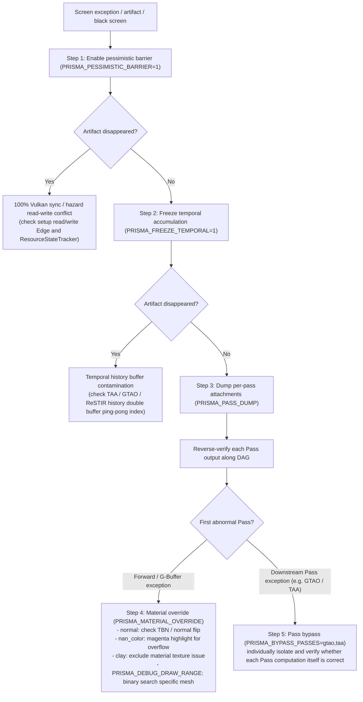

# Rendering exception isolation analysis and diagnosis methods (Rendering Debug & Isolation)

This document elaborates on the **four-dimensional orthogonal isolation analysis system** and standard operating procedure (SOP) for troubleshooting any graphics/shading exceptions (black screen, flickering, NaN explosion, normal anomalies, shadow artifacts, light leaks) in the Prisma rendering pipeline.

---

## I. Troubleshooting decision tree (SOP)

When unexpected artifacts appear on screen, locate the root cause via the following deterministic troubleshooting path:



---

## II. Four-dimensional isolation knob matrix

| Dimension | Environment variable | Description |
|-----------|---------------------|-------------|
| **Vulkan sync isolation** | `PRISMA_PESSIMISTIC_BARRIER=1` | Force inject global full-stage full-memory barrier (`ALL_COMMANDS`, `MEMORY_READ \| MEMORY_WRITE`) before and after each Pass, used to 100% confirm / exclude pipeline race and missing barrier |
| **Temporal accumulation isolation** | `PRISMA_FREEZE_TEMPORAL=1` | Force camera jitter to zero and set temporal history weight to 0, eliminating historical frame contamination interference |
| **Pass-level bypass isolation** | `PRISMA_BYPASS_PASSES=gtao,taa` | Comma-separated Pass name list (e.g. `gtao`, `taa`, `anf`); specified Passes will skip execution |
| **Material diagnostic override** | `PRISMA_MATERIAL_OVERRIDE=normal` | Replace scene shading with diagnostic view: `normal`, `depth`, `direct`, `shadow`, `specular`, `metallic`, `roughness`, `ao`, `emissive`, `clay` |
| **Draw range bisection** | `PRISMA_DEBUG_DRAW_RANGE=0..10` | Only draw meshes / DrawItems within specified index range, used for fast bisection to locate specific mesh or material causing exception |
| **Windowless pure offscreen execution** | `PRISMA_HEADLESS=N` | Create no OS window or winit event loop, pure background offscreen run N frames, check system compositor or scaling interference |

---

## III. Common practical troubleshooting recipes

### 1. Verify whether screen flicker is a sync bug
```bash
PRISMA_PESSIMISTIC_BARRIER=1 cargo run ...
```
If flicker disappears, some Pass wrote texture without correct pipeline stage / access mask.

### 2. Bypass post-processing and AO, directly observe pure ForwardPass shading
```bash
PRISMA_BYPASS_PASSES=gtao,taa PRISMA_PASS_DUMP=target/diag/passes PRISMA_PASS_DUMP_FRAME=2 cargo run ...
```

### 3. Troubleshoot geometry normal or lighting inversion
```bash
PRISMA_MATERIAL_OVERRIDE=normal cargo run ...
```

### 4. Automated Pass health scan and NaN localization
When running Pass Dump, the system automatically statistics non-finite and extrema of each Pass sample points:
```text
[INFO  prism_render::pass_dump] pass dump: target/diag/passes/frame_0002/forward_color.png min=0.003155 mean=0.284263 max=1.253906 non_finite=0
```
If output contains `non_finite > 0`, console outputs error and hints upstream shading equation has division by zero or unnormalized situation.

### 5. Pure direct light shadow and zero post-processing straight-through diagnosis (troubleshoot shadows and camera movement)
Strip all material textures, specular, ambient light, GTAO, TAA, and post-processing curves, directly observe pure shadow occlusion term (`1.0 = lit`, `0.0 = shadow`):
```bash
# Start pure shadow straight-through form
SPONZA_RENDER_MODE=raster \
PRISMA_MATERIAL_OVERRIDE=shadow \
PRISMA_BYPASS_PASSES=gtao,taa \
SPONZA_AUTO_EXPOSURE=0 \
SPONZA_TONEMAP_MODE=2 \
cargo run --manifest-path projects/sponza/Cargo.toml
```

**Shadow exception (e.g. shadow lost when camera moves) troubleshooting decision**:
1. **Downgrade observation**: if screen turns pure white (1.0) when camera moves, `sample_shadow` returns unoccluded.
2. **Two-end bisection**: Use `PRISMA_PASS_DUMP` to compare `shadow_map.png` between static and micro-move frames:
   - If `shadow_map.png` turns pure white after micro-move → generation end culling false kill (`cull_shadow_casters_multi` culled scene AABB) or light-space bounding box fitting degradation;
   - If `shadow_map.png` depth is normal after micro-move → sampling end matrix bias or UV out of bounds.
