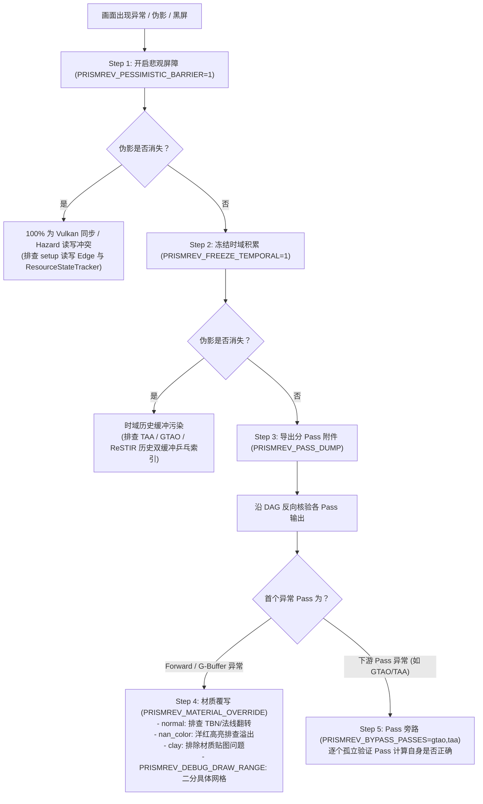

# 渲染异常隔离分析与诊断方法（Rendering Debug & Isolation）

本文档阐述在 PrismaRev 渲染管线中排查任何图形/着色异常（黑屏、闪烁、NaN 爆发、法线异常、阴影伪影、漏光）的**四维正交隔离分析体系**与标准作业程序（SOP）。

---

## 一、排查决策树（SOP）

当画面出现非预期伪影时，按以下确定性排查路径定位根因：



---

## 二、四维隔离旋钮矩阵

| 维度 | 环境变量 | 说明 |
|---|---|---|
| **Vulkan 同步隔离** | `PRISMREV_PESSIMISTIC_BARRIER=1` | 在每个 Pass 前后强制注入全局全阶段全内存屏障（`ALL_COMMANDS`，`MEMORY_READ \| MEMORY_WRITE`），用于 100% 确认/排除管线竞态与屏障缺失 |
| **时域积累隔离** | `PRISMREV_FREEZE_TEMPORAL=1` | 强制将相机微抖动（Jitter）归零，并设置历史时域权重为 0，消除历史帧污染干扰 |
| **Pass 级旁路隔离** | `PRISMREV_BYPASS_PASSES=gtao,taa` | 逗号分隔的 Pass 名称列表（如 `gtao`, `taa`, `anf`），被指定的 Pass 将跳过执行 |
| **材质诊断覆写** | `PRISMREV_MATERIAL_OVERRIDE=normal` | 将场景着色替换为诊断视图：`normal`, `depth`, `direct`, `shadow`, `specular`, `metallic`, `roughness`, `ao`, `emissive`, `clay` |
| **绘制项范围二分** | `PRISMREV_DEBUG_DRAW_RANGE=0..10` | 仅绘制指定索引范围内的网格/DrawItem，用于快速二分定位引发异常的具体网格或材质 |
| **无窗口纯离屏执行** | `PRISMREV_HEADLESS=N` | 不创建任何操作系统窗口与 winit 事件循环，纯后台离屏运行 N 帧，排查系统合成器或缩放干扰 |

---

## 三、常用实战排查配方

### 1. 验证画面闪烁是否为同步 Bug
```bash
PRISMREV_PESSIMISTIC_BARRIER=1 cargo run ...
```
若闪烁消失，说明某个 Pass 写入纹理未配置正确的管线阶段/访问掩码。

### 2. 旁路后处理与 AO，直接观察 ForwardPass 纯净着色
```bash
PRISMREV_BYPASS_PASSES=gtao,taa PRISMREV_PASS_DUMP=target/diag/passes PRISMREV_PASS_DUMP_FRAME=2 cargo run ...
```

### 3. 排查几何体法线或光照反转
```bash
PRISMREV_MATERIAL_OVERRIDE=normal cargo run ...
```

### 4. 自动化 Pass 健康扫描与非数（NaN）定位
运行 Pass Dump 时，系统自动统计各 Pass 采样点的非数与极值：
```text
[INFO  prism_render::pass_dump] pass dump: target/diag/passes/frame_0002/forward_color.png min=0.003155 mean=0.284263 max=1.253906 non_finite=0
```
若输出中包含 `non_finite > 0`，控制台将输出错误并提示上游着色方程存在除以零或未归一化情况。

### 5. 纯直接光阴影与零后处理直通诊断（排查阴影与相机运动）
剥离所有材质纹理、高光、环境光、GTAO、TAA 与后处理曲线，直接观察纯阴影遮挡项（$1.0 = \text{光照}, 0.0 = \text{阴影}$）：
```bash
# 启动纯阴影直通形态
SPONZA_RENDER_MODE=raster \
PRISMREV_MATERIAL_OVERRIDE=shadow \
PRISMREV_BYPASS_PASSES=gtao,taa \
SPONZA_AUTO_EXPOSURE=0 \
SPONZA_TONEMAP_MODE=2 \
cargo run --manifest-path projects/sponza/Cargo.toml
```

**阴影异常（如相机一动就丢失阴影）排查决策**：
1. **降维观察**：若相机移动时全屏变纯白（1.0），说明 `sample_shadow` 返回未遮挡。
2. **两端二分**：使用 `PRISMREV_PASS_DUMP` 对比静止帧与微移帧的 `shadow_map.png`：
   - 若微移后 `shadow_map.png` 变纯白 $\rightarrow$ 生成端剔除误杀（`cull_shadow_casters_multi` 剔除了场景 AABB）或光空间包围盒拟合退化；
   - 若微移后 `shadow_map.png` 深度正常 $\rightarrow$ 采样端矩阵偏差或 UV 越界。
