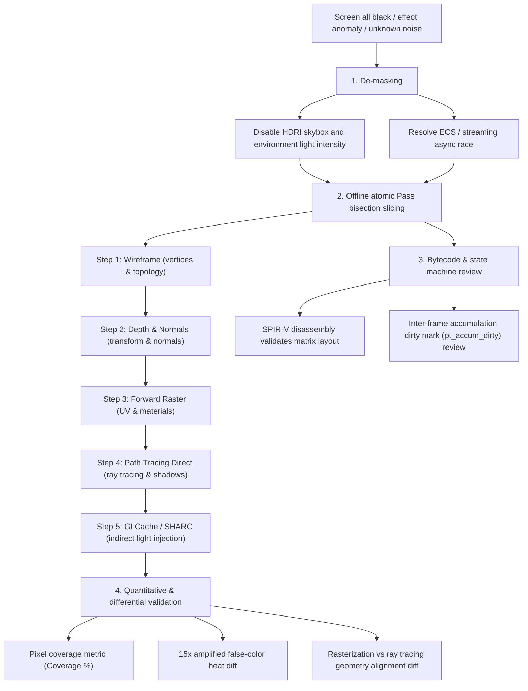

# Rendering Pipeline Investigation and Binary Diagnosis Methodology

This document systematically summarizes standard troubleshooting procedures and diagnostic workflows for screen anomalies, black screens, or non-convergence encountered in Prisma's graphics pipeline (rasterization, hardware ray tracing / path tracing, RTXGI/SHARC radiance cache).

Core principles: **environment decoupling eliminates illusions, offline slicing bisects pipeline, bytecode-level state machine review, quantitative falsifiable differentiation**.

---

## I. Troubleshooting Overview and Mental Model



---

## II. Four Core Troubleshooting Dimensions

### 1. Environment Decoupling and Illusion Removal (De-masking)

> **"In complex rendering pipelines, the most dangerous bugs are often masked by gorgeous backgrounds or upper-level post-processing."**

- **Disable global skylight / HDRI Skybox**:
  - Panorama texture or emissive sky sphere fills the entire viewport, creating an intuitive misconception that "the pipeline is running normally, with environment reflections," thereby masking geometry loss, camera clipping, or culling anomalies.
  - **Rule**: During geometry and basic lighting troubleshooting, must force skybox to `enabled: false, intensity: 0.0`, retain pure black background, ensuring every pixel appearing in the viewport comes from real scene meshes.
- **Decouple streaming async loading and screenshot timing**:
  - Complex 3D assets (e.g. Crytek Sponza with 103 submeshes) depend on async IO and deserialization at startup. If screenshot is triggered unconditionally based only on frame count (e.g. frame 90), the model may not yet be mounted to the render list when screenshotting.
  - **Rule**: Screenshot guard must verify data readiness:
    ```rust
    let frame_plan = screenshot.as_ref().filter(|plan| {
        !screenshot_done
            && plan.fires_on(frame_count + 1)
            && (!packet.draw_items.is_empty() || frame_count >= 300)
    });
    ```
- **Write independent headless offline test harness**:
  - When encountering black screen anomalies, prioritize writing `GraphRenderer::offscreen_new(w, h, None)` offline test, directly synchronously import glTF and register, eliminating window system (Winit / X11 / Wayland), UI floating window, and main loop event pump interference.

---

### 2. Pipeline Binary Slicing

Decompose the rendering pipeline from input to output into indivisible single Passes, outputting single-step disk screenshots:

| Diagnostic Pass | Check Target | Anomaly | Root Cause Range |
|-----------------|-------------|---------|------------------|
| **Step 1: Wireframe** | Vertex & index buffer topology | All black, or lines messed up into spikes | Submesh not imported, IndexBuffer out of bounds, vertex stride misaligned |
| **Step 2: Depth Buffer** | Perspective projection & Z continuity | All white / all black, or near clipped | Near/far clip plane params reversed, Projection matrix missing, Reverse-Z depth test function misconfigured (`GREATER` vs `LESS`) |
| **Step 3: View Normals** | Vertex normals & face culling | Curved cylinder normals missing smoothing, backface penetration | `cull_mode` culling error, normal not normalized, Slang matrix transpose causing inversion |
| **Step 4: Forward Raster** | Material texture & direct lighting | Texture map pure black or pure white | Descriptor set binding drift, sampler not configured, lighting shader constants out of bounds |
| **Step 5: Path Tracing Direct** | BVH & ray hit shading | Pure noise speckles, no geometric shadows | TLAS / BLAS acceleration structure doesn't include the mesh, temporal accumulation buffer cleared every frame |
| **Step 6: GI Cache (SHARC)** | Radiance spatial hash & bounce | Indirect light completely unchanged | VRAM initial fill not completed, compute pipeline sync barrier missing, hash key 64-bit atomic op not enabled |

---

### 3. Bytecode and Underlying State Machine Review

> **"High-level API and language binding layers often hide unconverged state traps or compiler semantic deviations; do not blindly trust existing APIs."**

1. **Shader bytecode disassembly (`spirv-dis`) verification**:
   - Modern shader compilers (e.g. Slang) when compiling to Vulkan SPIR-V, matrix attributes default to `RowMajor`, generating `OpVectorTimesMatrix %vec %mat` at multiplication.
   - This layout is naturally equivalent to column-vector multiplication at the underlying math level with column-major arrays passed from Rust. If blindly adding `mat_transpose` on the host side, it instead causes double transpose, leading to geometry being flattened or projection flipped. When encountering matrix issues, derive from disassembled bytecode.
2. **Accumulation buffer and dirty mark (Temporal State) review**:
   - Path tracing relies on weighting new samples into accumulation texture each frame:
     $$\text{Accum}_{N} = \frac{\text{Accum}_{N-1} \times (N-1) + \text{Color}_{\text{new}}}{N}$$
   - If the host convenience wrapper hardcodes `pt_accum_dirty: true`, every frame forcibly resets sample count and clears accumulation texture, leaving the screen permanently at $N=1$ high-frequency speckle state.

---

### 4. Quantitative Metrics and Amplified Differential Validation

1. **Effective pixel coverage metric**:
   - Statistic percentage of valid pixels over full image:
     $$\text{Coverage} = \frac{\sum_{(x,y)} [\text{Pixel}(x,y) \neq \text{Background}]}{W \times H}$$
   - Example measured data:
     - Forward rasterization: $518,400 / 518,400 = 100.0\%$
     - Wireframe: $449,604 / 518,400 = 86.7\%$
     - Depth perspective: $347,159 / 518,400 = 67.0\%$
   - **Value**: Instantly judge whether any submesh is missing or camera not aligned to geometry.
2. **15x amplified false-color heat diff**:
   - Indirect light (GI) bounce energy is usually far lower than direct light, human eye extremely hard to discern its contribution via side-by-side comparison.
   - **Algorithm**:
     $$\text{Diff}(x, y) = \min(255, |\text{Image}_{\text{on}}(x, y) - \text{Image}_{\text{off}}(x, y)| \times 15)$$
   - **Judgment criteria**:
     - If changed pixels = 0, GI cache is not taking effect at all (possibly no-op or pipeline not connected).
     - If changed pixels concentrated at corridor backlight concave corners, dome column junctions, and present continuous gradient (e.g. Sponza measured 44,159 pixels lit, coverage 8.52%), then physically proves indirect light truly injected.
3. **Cross-pipeline geometry structural diff**:
   - Subtract raster result from ray tracing result: $|\text{Raster} - \text{PathTrace}|$.
   - Contour edges must be seamlessly aligned (0 pixel edge displacement), diff purely comes from brightness difference between direct light model and global illumination integration.

---

## III. Standard Self-Check Checklist

Before submitting any rendering-related change, confirm in order:

- [ ] Observed geometry form with skybox disabled.
- [ ] Offline test can independently and stably reproduce via `cargo test --test debug_pipeline_*` in windowless environment.
- [ ] Wireframe topology clear, no degenerate triangles, no large-area penetration.
- [ ] Depth buffer and normal buffer gradient smooth, culling mode consistent with front/back clockwise convention.
- [ ] Path tracing runs multiple frames under fixed camera, noise obviously converges with sample accumulation, no per-frame flicker.
- [ ] Indirect light (RTXGI / SHARC) produces 15x amplified diff heatmap, lit pixel physical distribution reasonable.
- [ ] Run `python scripts/pr_ready.py --base origin/dev --quick` all green `✅`.
